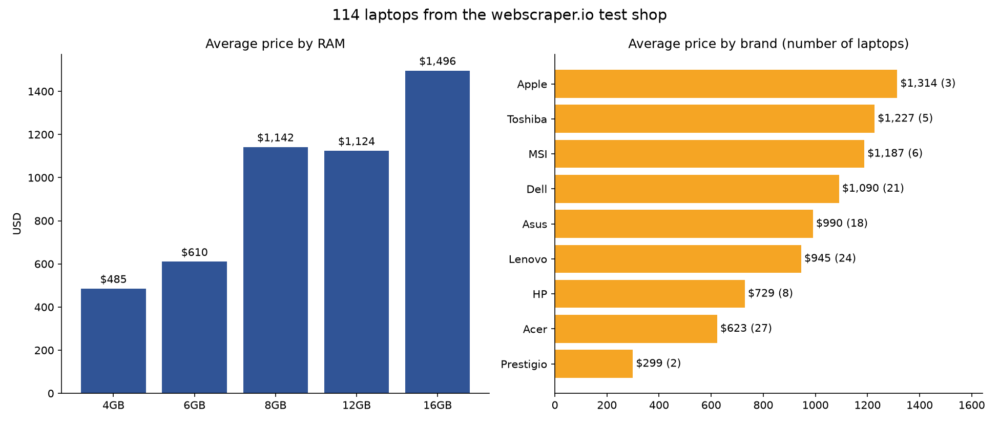

# laptop-scraper

Scrapes all 117 laptops from the [webscraper.io test shop](https://webscraper.io/test-sites/e-commerce/static/computers/laptops), turns the free-text descriptions into proper spec columns with regex, and builds an Excel report and a chart with pandas and matplotlib.

The descriptions on the site are typed by hand and not very consistent:

```
15.6", Core i5-4200M, 4GB, 500GB, Win7 Pro 64bit
Acer Aspire ES1-732 Black, 17.3" HD+, Celeron, N3350, 4GB, 1TB, Windows 10 Home
Acer Aspire 3 A315-21, 15.6", AMD A4-9120. 4GB. 128GB SSD, Linux
Lenovo Legion Y520-15IKBM, Black, 15.6" FHD IPS, Core i5-7300HQ, 8 GB, 128GB SSD + 2 TB HDD, NVIDIA GeForce GTX 1060 6 GB, FreeDOS + Windows 10 Home
```

so each part (screen, CPU, RAM, drives, GPU, OS) has its own pattern in `laptop.py`. They're checked against every description on the site in the tests.

## Extracted data

For each laptop: brand, title, price, rating, reviews and from the description: screen size, resolution, touch screen, CPU, CPU family and generation, RAM, storage (every drive with its type), GPU, video memory and OS.

The site has a few products with the description of a different laptop (e.g. "Asus ROG Strix GL553VD-DM535T" described as an Apple MacBook Air). These get flagged, listed on their own sheet and left out of the stats.

## Output

- `laptops.xlsx`
  - **Laptops** - all the data
  - **By brand**, **By RAM**, **By CPU** - number of laptops, average/min/max price
  - **Price bands** - laptops per $250 range
  - **Avg price brand x RAM** - pivot table
  - **Best value (8GB+ SSD)** - the 10 cheapest laptops with at least 8GB RAM and an SSD
  - **Data issues** - products whose description belongs to another laptop
  - **Your picks** - only with `--interactive`
- `laptops.csv`
- `chart.png` - average price by RAM and by brand



## Project structure

```
laptop.py    Laptop dataclass with an inner Specs class, all the regex patterns
scraper.py   BaseScraper (abstract), LaptopScraper, Paginator (iterator), PageCache
catalog.py   Catalog class, pandas report, Excel and chart
main.py      command line
tests/       regex tests on the real descriptions + a local copy of the shop
```

## Setup

```
pip install -r requirements.txt
```

Needs Python 3.10 or newer (the code uses `match`).

## Usage

```
python main.py
```

On a Mac use `python3` instead of `python`.

Downloaded pages are saved in a `cache` folder for 24 hours, so running it again is instant and doesn't hit the site.

```
python main.py --interactive      # asks for min RAM, max price, brand and SSD after scraping
python main.py --cache-hours 1    # treat cached pages older than 1 hour as expired
python main.py --no-cache         # always download
python main.py --clear-cache      # delete the cached pages first
python main.py --delay 1          # wait 1 second between requests (default 0.5)
```

Example of the interactive mode:

```
Filter the laptops (press Enter to skip a question)
Minimum RAM in GB: 8
Maximum price in $: 1200
Brand, e.g. Dell: dell
SSD only? (y/n): y

6 laptops match:
  Dell Inspiron 15 (7567) Black ($1,098.42): Core i5-7300HQ, 8GB RAM, 256GB SSD
  Dell Latitude 5280 ($1,102.66): Core i5-7300U, 8GB RAM, 256GB SSD
  ...
```

## Tests

```
pip install pytest
python -m pytest
```

The tests run against a local copy of the 20 shop pages, so they don't send requests to the real website.

Built with requests, BeautifulSoup, pandas, matplotlib and openpyxl.
